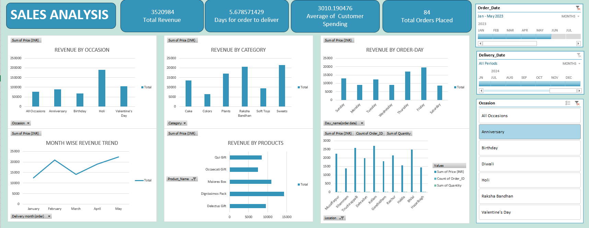

#  FNP Sales Analysis Dashboard (Excel)

An end-to-end sales analysis of **Ferns N Petals (FNP)**, one of India's best-known gifting brands. The project examines revenue patterns, customer purchasing habits, and product performance, and turns them into practical insights that can sharpen marketing decisions and improve day-to-day operations.

Everything, from data cleaning to modelling to the final dashboard, was done in **Microsoft Excel**.

---

## 📌 Table of Contents
- [Project Objective](#-project-objective)
- [Dataset](#-dataset)
- [Tools & Techniques](#-tools--techniques)
- [Project Workflow](#-project-workflow)
- [Dashboard Overview](#-dashboard-overview)
- [Key Insights](#-key-insights)
- [Recommendations](#-recommendations)
- [Repository Structure](#-repository-structure)
- [How to Use](#-how-to-use)

---

## 🎯 Project Objective
To answer key business questions such as:
- Which **occasions** and **product categories** generate the most revenue?
- How does revenue change across **months** and **days of the week**?
- Which **products** and **locations** perform best?
- How long does it take to **deliver** an order, and how much does an average customer spend?

---

## 🗂 Dataset
The data is split across three CSV files in the `data/` folder:

| File | Description | Key Columns |
|------|-------------|-------------|
| `customers.csv` | Customer details | Customer_ID, Name, City, Contact, Email, Gender, Address |
| `orders.csv` | Order-level transactions | Order_ID, Customer_ID, Product_ID, Quantity, Order_Date, Order_Time, Delivery_Date, Delivery_Time, Location, Occasion |
| `products.csv` | Product catalogue | Product_ID, Product_Name, Category, Price (INR), Occasion |


---

## 🛠 Tools & Techniques
- **Microsoft Excel**
- **Data Cleaning:** removing duplicates, fixing data types, handling blanks, standardising text and date formats
- **Data Modelling:** combining the three tables using lookup functions (`XLOOKUP` / `VLOOKUP` / `INDEX-MATCH`)
- **Feature Engineering:** calculated columns such as Revenue, Delivery Days, Order Month, and Day of Week (`TEXT`, `DATEDIF`, `MONTH`)
- **Analysis:** Pivot Tables and Pivot Charts
- **Visualisation:** interactive dashboard with Slicers and Timelines

---

## 🔄 Project Workflow
1. **Data Import:** loaded the three CSV files into Excel
2. **Data Cleaning:** checked for duplicates, nulls, and inconsistent formats
3. **Data Modelling:** linked orders, customers, and products into one analysis-ready table
4. **Calculated Fields:** derived revenue, delivery time, order month, and order day
5. **Pivot Analysis:** summarised revenue by occasion, category, product, location, and time
6. **Dashboard Building:** assembled KPI cards, charts, and slicers into one interactive view

---

## 📊 Dashboard Overview



**KPIs tracked**
| Metric | Value |
|--------|-------|
| Total Revenue | ₹[3,520,984] |
| Avg. Delivery Time | [5.68] days |
| Avg. Customer Spending | ₹[3,010.19] |
| Total Orders Placed | [84] |

**Visuals included**
- Revenue by Occasion
- Revenue by Category
- Revenue by Order Day
- Month-wise Revenue Trend
- Revenue by Products
- Orders, Quantity & Revenue by Location

**Interactive filters:** Order Date timeline, Delivery Date timeline, Occasion slicer

---

## 💡 Key Insights
- 🎉 **Holi** is the highest-revenue occasion, followed by **Valentine's Day**.
- 🍬 **Sweets**, **Raksha Bandhan** gifts, and **Plants** lead in category revenue.
- 📅 **Friday** and **Thursday** are the strongest order days.
- 📈 Monthly revenue peaks in **February**, dips in **March**, then climbs steadily through **May**.
- 🎁 **Dignissimos Pack** and **Maiores Box** are among the top-earning products.
- 🚚 Orders take about **[5.7] days** on average to be delivered.


---

## ✅ Recommendations
- Ramp up marketing and inventory ahead of **festive peaks** like Holi and Valentine's Day.
- Run targeted promotions on **low-revenue days** to even out demand.
- Promote and bundle the **top-performing products and categories**.
- Work on shortening **delivery time** to improve customer satisfaction.
- Focus on high-performing **locations** while exploring growth in weaker ones.

---

## 📁 Repository Structure
```
FNP-Sales-Analysis/
│
├── data/
│   ├── customers.csv
│   ├── orders.csv
│   └── products.csv
│
├── FNP_Sales_Analysis.xlsx
├── images/
│   └── dashboard.png
└── README.md
```


## 👤 Author : Sambita Dutta
🔗 [LinkedIn](https://www.linkedin.com/in/sambita-dutta8/) | 📧 sambitadutta8@gmail.com 

⭐ If you found this project useful, consider giving it a star!
